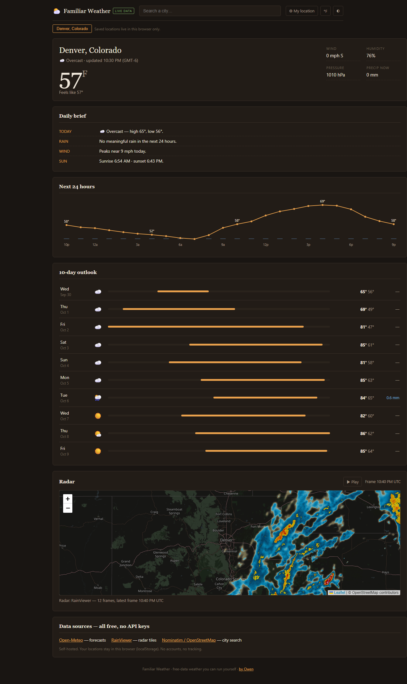

# Familiar Weather

A self-hosted weather website — everything **Weather Extension** charges for, on free data, in one small repo.

Current conditions · 24-hour chart · 10-day outlook · animated radar · city search · saved locations · °F/°C · dark/light. No accounts, no API keys, no tracking. Saved locations live only in your browser.



## Why

[Weather Extension](https://weatherextension.com) is a nice product, but its Pro tier (daily brief, alerts-style planning, more locations, radar conveniences) is paid. Every one of those features is buildable on **free, keyless APIs** — this repo proves it.

## Free data sources (all verified, no keys)

| Source | Used for | Limits |
|---|---|---|
| [Open-Meteo](https://open-meteo.com) | current, hourly, 10-day forecast | free, non-commercial, 10k req/day |
| [RainViewer](https://www.rainviewer.com) | radar tiles + 10-min animation | free with attribution |
| [Nominatim / OSM](https://nominatim.org) | city search + reverse geocode | 1 req/s — the app throttles + aborts |
| [OpenStreetMap tiles](https://openstreetmap.org) | radar basemap (CSS-filtered dark) | fair-use tile policy |

## Run it

No build step, no dependencies for the site itself:

```bash
python server.py            # http://127.0.0.1:8123
```

…or with Podman (rootless):

```bash
podman build -t familiar-weather .
podman run -d --name familiar-weather -p 8123:8123 familiar-weather
```

…or just open `index.html` directly (only file:// caveat: geolocation may be blocked by the browser).

### Expose over Tailscale

```bash
tailscale serve --bg 8123          # https://<machine>.<tailnet>.ts.net/
```

Private HTTPS across your tailnet, nothing public.

## Verify it renders (what this repo's checks assert)

`scripts/verify_render.py` drives real headless Chromium and asserts:

- current temp + 4 metric tiles populated, no stuck "loading" state
- hourly SVG has 24 hover points; daily list has 10 rows
- radar map loads RainViewer tiles; basemap tiles come only from `tile.openstreetmap.org`
- °F↔°C toggle changes the temperature; city search selects a new place and re-places the radar
- mobile viewport applies the media-query overrides; zero JS page errors

```bash
pip install playwright && playwright install chromium
python scripts/verify_render.py
```

## Files

```
index.html   markup
styles.css   warm-dark design; mobile only via @media overrides
app.js       state, fetch+retry, SVG hourly chart, Leaflet radar, localStorage places
server.py    stdlib static server, no-cache headers
Dockerfile   python:3.12-slim, one image
```

## Upgrade path (documented, not built)

- **US alerts**: `api.weather.gov` alerts polygon endpoint, free + keyless — render an alerts strip above the daily brief.
- **Air quality**: Open-Meteo `/v1/air-quality`, same keyless model.
- **PWA**: manifest + service worker for installability and offline last-known forecast (labeled `NON-LIVE DATA` when stale).
- **Multi-location dashboard**: grid of current panels per saved place.

## Credit

Forecast data by Open-Meteo (CC-BY-4.0). Radar by RainViewer (free tier, attribution required). Geocoding © OpenStreetMap contributors (ODbL). Not affiliated with Weather Extension.

MIT — do what you want, attribution appreciated. By [Owen](https://github.com/THEROCKSSS).
